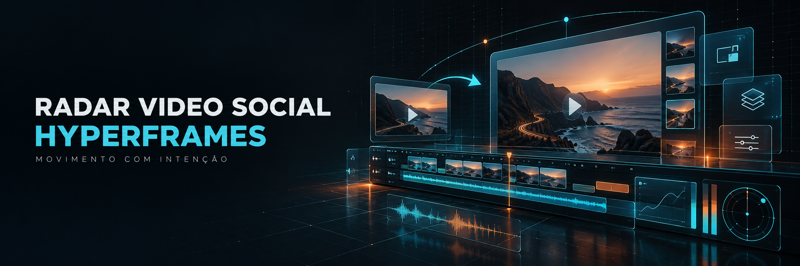
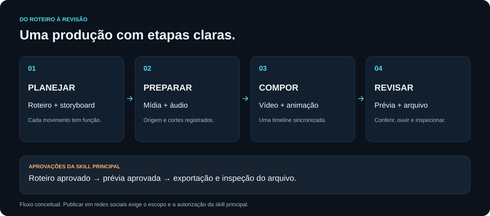
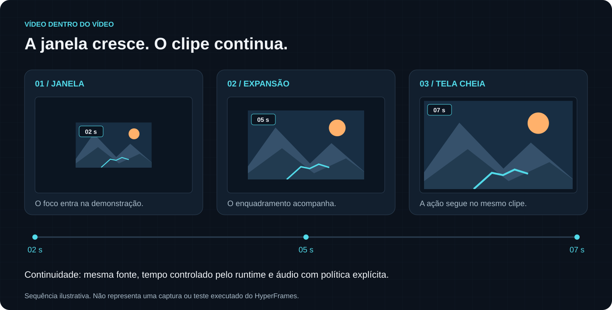
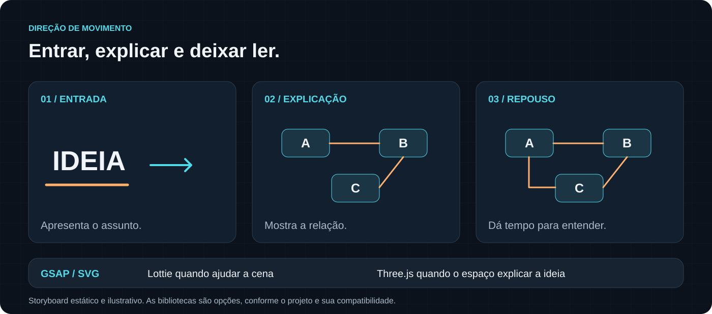
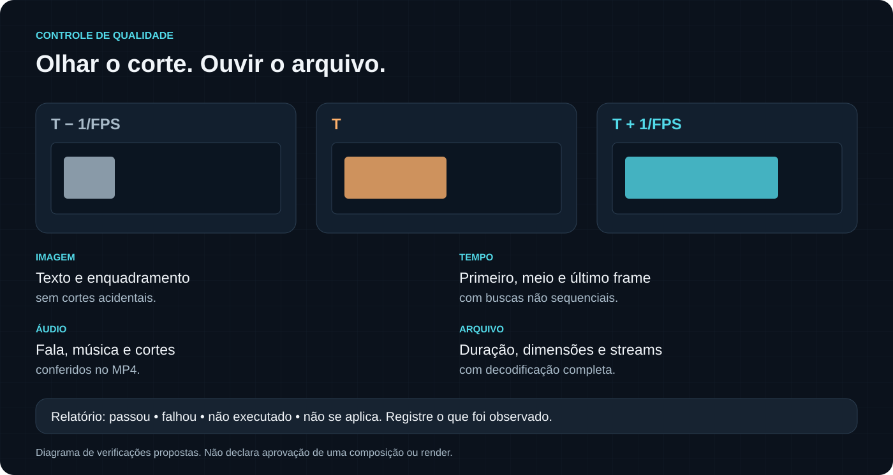

# Radar Vídeo Social + HyperFrames

**Do roteiro aprovado à composição audiovisual, com movimento, vídeo em janela e revisão de qualidade.**

Uma extensão da etapa de produção da `radar-video-social`. O pacote reúne orientações de composição, animação, mídia, áudio e exportação para quem já usa uma skill editorial e quer organizar melhor a produção com HyperFrames.

[Conheça os recursos](#recursos) · [Integre à sua skill](#integração) · [Veja as verificações](VERIFICACAO.md) · [Consulte as fontes](references/hyperframes-fontes.md)

> As cinco imagens deste README são ilustrações conceituais. Não são capturas do HyperFrames nem evidências de uma composição renderizada. A extensão contém documentação e exemplos técnicos; a skill completa e um projeto de vídeo pronto não fazem parte deste repositório.

## Um fluxo que dá para acompanhar



O módulo entra depois das decisões editoriais. Ele ajuda a transformar o roteiro aprovado em cenas, organizar as mídias e escolher o que verificar antes da entrega. Pesquisa, seleção de temas, perfil editorial e autorizações continuam sob as regras da skill principal.

| Etapa | O que o módulo orienta | Registro sugerido |
|---|---|---|
| Planejar | Definir a função de cada movimento e o tempo de leitura. | `MOTION-PLAN.md` |
| Preparar | Conferir origem, duração, dimensões e política de áudio dos clipes. | `ASSET-MANIFEST.json` |
| Compor | Organizar cenas, camadas, vídeos e animações na mesma timeline. | Composição editável |
| Revisar | Conferir quadros, cortes, áudio e o arquivo exportado. | `QA-REPORT.md` |

Esses registros são criados no projeto de produção quando o módulo é integrado. Seus nomes descrevem o fluxo proposto; não indicam que esses artefatos já foram produzidos neste pacote.

## Recursos

### Vídeo dentro do vídeo



Uma demonstração pode começar em uma janela e ocupar a tela conforme a explicação avança. O módulo orienta o enquadramento, a continuidade do clipe e a sincronização com a timeline, incluindo a escolha explícita de manter, separar ou remover o áudio.

Também cobre tela dividida, clipes em molduras e outras composições. O layout deve proteger a informação importante: uma interface, um rosto, uma legenda ou o detalhe que está sendo explicado.

[Leia o módulo de produção](references/hyperframes-producao-avancada.md)

### Movimento que ajuda a entender



Entradas progressivas, diagramas construídos, mudanças de foco e transições podem acompanhar a fala. O plano de cenas define por que cada elemento se move e quando a imagem precisa ficar tranquila para permitir a leitura.

| Recurso | Quando considerar |
|---|---|
| GSAP e SVG | Tipografia, camadas, caminhos, gráficos e transições 2D. |
| Lottie | Animações vetoriais que contribuam para a cena, com origem e licença conferidas. |
| Three.js e WebGL | Câmera, profundidade ou relações espaciais que ajudem a explicar a ideia. |
| Vídeo local | Demonstrações e imagens de apoio com procedência registrada. |

As bibliotecas são opções de produção, conforme o projeto. O módulo orienta movimentos reproduzíveis ao buscar um instante da timeline e pede testes separados para as técnicas incorporadas.

### Áudio e mídia com decisões explícitas

O arquivo de comandos reúne diagnóstico com FFprobe, preparação H.264 All-I com ou sem áudio, extração de WAV e inspeção do MP4. Os exemplos preservam o original e usam proteção contra sobrescrita.

All-I é uma alternativa para casos em que a busca de frames precisa ser investigada. Pode aumentar bastante o tamanho do arquivo. Os presets documentados são voltados a SDR opaco; HDR, transparência e áudio multitrilha exigem avaliação própria.

[Consulte os comandos e seus limites](references/hyperframes-comandos.md)

### Qualidade conferida no arquivo final



Um comando terminar sem erro é uma evidência técnica. A revisão também precisa conferir o que aparece e o que se ouve: cortes, último frame válido, leitura das legendas, continuidade do vídeo e presença do áudio esperado.

O relatório distingue **passou**, **falhou**, **não executado** e **não se aplica**. Uma ilustração, um snapshot criado ou um arquivo antigo não comprova um novo render aprovado.

[Veja os critérios de aceite](references/hyperframes-producao-avancada.md#14-critérios-de-aceite-e-evidências)

## Integração

Comece com uma cópia local desta extensão:

```bash
git clone https://github.com/reimon/radar-video-social-hyperframes.git
cd radar-video-social-hyperframes
```

Clonar o repositório disponibiliza os documentos. A integração é uma alteração separada na skill existente:

1. Localize e leia o `SKILL.md` real e suas referências. Se houver várias cópias, compare-as e confira links simbólicos antes de editar. Leia o perfil e o estado da produção somente no ambiente privado.
2. Faça backup dos arquivos que serão alterados e registre seus hashes. Compare possíveis conflitos antes de copiar qualquer arquivo.
3. Copie os três arquivos `references/hyperframes-*.md` desta extensão para a pasta `references/` da skill. Preserve os arquivos que já existem ali.
4. Incorpore [SKILL-PATCH.md](SKILL-PATCH.md) à etapa de produção do `SKILL.md`, mantendo nome, frontmatter e regras editoriais. Se os marcadores do módulo já existirem, atualize o bloco sem duplicá-lo.
5. Confira os links relativos e os contratos da versão instalada. Execute um ensaio isolado antes de usar a integração em produção.

Não renomeie o README ou o módulo para `SKILL.md`. A skill precisa referenciar explicitamente os documentos que serão carregados.

O [prompt de integração](PROMPT-INTEGRACAO.md) detalha o procedimento com caminhos genéricos. Use-o no ambiente que tenha acesso autorizado aos arquivos. A extensão funciona como orientação pelo chat e não exige configurar um Dot.

## O que vem no repositório

```text
radar-video-social-hyperframes/
├── README.md
├── SKILL-PATCH.md
├── PROMPT-INTEGRACAO.md
├── VERIFICACAO.md
├── .gitignore
├── references/
│   ├── hyperframes-producao-avancada.md
│   ├── hyperframes-comandos.md
│   └── hyperframes-fontes.md
└── docs/
    ├── VISUAIS.md
    └── images/
        ├── capa.png
        ├── fluxo-producao.svg
        ├── video-em-janela.svg
        ├── movimento.svg
        └── qualidade.svg
```

| Documento | Para que abrir |
|---|---|
| [SKILL-PATCH.md](SKILL-PATCH.md) | Incorporar o ponto de entrada do módulo à skill principal. |
| [Produção avançada](references/hyperframes-producao-avancada.md) | Planejar e organizar composição, mídia, movimento e revisão. |
| [Comandos de apoio](references/hyperframes-comandos.md) | Preparar clipes e consultar exemplos de validação e exportação. |
| [Fontes e compatibilidade](references/hyperframes-fontes.md) | Rastrear as fontes técnicas e os padrões históricos citados. |
| [Prompt de integração](PROMPT-INTEGRACAO.md) | Conduzir uma integração futura sem substituir a skill inteira. |
| [Verificação](VERIFICACAO.md) | Distinguir testes relatados, verificações executadas e pendências. |
| [Origem das imagens](docs/VISUAIS.md) | Entender como as ilustrações foram criadas e o que representam. |

## Pré-requisitos e compatibilidade

Para integrar, você precisa de uma skill principal existente e acesso autorizado ao projeto. Para produzir, precisa de um ambiente HyperFrames compatível, Node.js e FFmpeg/FFprobe. A documentação consultada na preparação original indicava Node.js 22 ou superior; confirme os requisitos da versão que será utilizada.

Use o CLI ou wrapper fixado pelo projeto. Confira `--help`, atributos de mídia, adapters e presets antes de aplicar os exemplos. `npx` pode baixar um pacote ausente, por isso verifique a instalação antes de usá-lo para diagnóstico. Esta extensão não instala nem atualiza dependências.

GSAP, seus plugins, Lottie e Three.js precisam ser conferidos quando forem usados: versão, imports, compatibilidade e termos. As URLs em `main` podem mudar; registre o commit ou a revisão consultada. Código, marcas e mídias dos exemplos podem ter condições de uso diferentes.

## O que foi verificado

| Escopo | Situação |
|---|---|
| Preparação original do pacote | Registrou testes FFmpeg com mídia sintética de dois segundos, incluindo All-I, áudio opcional, decodificação, proteção de saída e WAV. Os resultados foram preservados como relatos. |
| Revisão para a primeira publicação | Leitura dos sete arquivos recebidos, remoção de caminhos pessoais e identificadores editoriais, conferência dos oito arquivos iniciais, links, comandos, JSON e padrões comuns de segredos. |
| Atualização visual deste README | Inclusão de uma capa original e quatro diagramas conceituais. A origem e o escopo estão documentados em `docs/VISUAIS.md`. |
| Integração em uma skill | Pendente. |
| Execução do HyperFrames e renderização | Não executadas nesta publicação. |
| Ensaios GSAP, Lottie e Three.js | Pendentes no runtime de destino. |
| Inspeção audiovisual de um vídeo exportado | Pendente. |

O [relatório completo](VERIFICACAO.md) separa a preparação original das verificações desta cópia pública. A atualização do README não instala dependências, não altera perfis editoriais e não modifica conteúdo em produção.

## Contribuições e uso dos materiais

Mantenha as alterações no escopo da extensão, preserve os comandos e as fontes e informe quais testes foram executados. Revise os arquivos preparados para commit mesmo com o `.gitignore` ativo. Perfis editoriais, credenciais, `.env`, dados de clientes, conversas, backups e mídias privadas devem permanecer fora do repositório.

Nenhuma licença foi escolhida para este repositório. As ferramentas e fontes citadas mantêm seus próprios termos.

---

Módulo 1.0 · Preparação original: 15/10/2026 · Documentação visual: 15/10/2026
